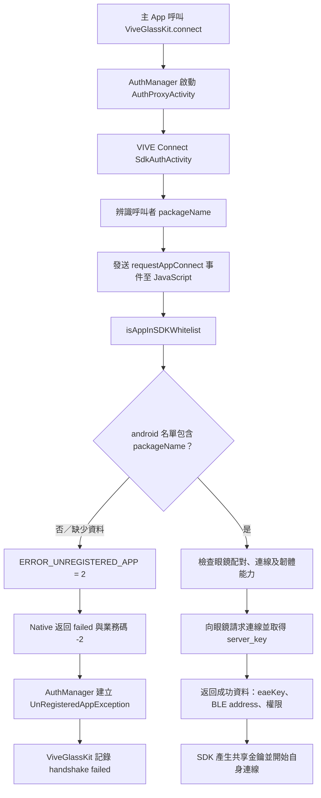

# ViveGlassKit 與 VIVE Connect 授權流程分析

調查日期：2026-10-09。檢查版本：HTC Android SDK `0.6.0`、手機上取得的 VIVE Connect `1.4.1387452`（versionCode `200077`）。

## 1. 結論與證據界線

**已找到「未註冊」的具體判定分支：VIVE Connect 的 SDK 套件白名單檢查。** `ViveGlassKit` 負責呼叫官方 App，再把官方 App 的業務錯誤碼轉成 SDK 例外。

VIVE Connect 的 Hermes JavaScript 位元碼顯示：

1. `SDK_WHITELIST_CHECK_ENABLED` 在此版本為 `true`。
2. `isAppInSDKWhitelist(eventData)` 取得服務端的 `verifiedapps`；Android 分支檢查 `verifiedapps?.android?.includes(packageName) === true`。
3. 若檢查為 false，設定 `ERROR_UNREGISTERED_APP = 2`，拋出 `App not in whitelist`，跳過後續眼鏡連線請求。
4. Native Activity 將事件 `2` 轉成 `result_status_code = "-2"`。
5. SDK 將 `"-2"` 轉成 `UnRegisteredAppException`，最終印出 `The application is not registered.`。

**白名單比對使用 HTC 配置服務提供的 Android 套件名單；沒有呼叫 Google 開發人員驗證狀態 API，也沒有比對我們 APK 的簽署憑證 SHA-256。** 後續追蹤確認 Connect 取得內部 API key 時會另檢查它自己的包名／簽章，兩層檢查不同，見 §9。Google Console 登錄不會由本機 Gradle 或 SDK 自動寫入這份名單。HTC 如何審核及更新名單，仍須由 HTC 確認；此調查不能代表其後端所有業務規則。

同日稍後已還原官方 App 指定端點的原生金鑰取得流程，由電腦取得 **HTTP 200 的實際 JSON**。`verifiedapps.android` 有 50 筆（49 個不重複包名），包含官方 sample，**不包含 `com.beefsoup.ai.glass` 或 `edu.ncku.aiglass`**。原始回應見 [完整 JSON](evidence/htc_verified_apps_2026-10-09.json)，取得方法及時間見 [回應取得紀錄](SDK_WHITELIST_CAPTURE_PLAN.md)。

這證明目前該端點有效名單未收錄主專案，足以觸發上述拒絕分支，與既有日誌相符。尚未讀取手機先前那次回應／快取，因此不排除手機另外遭遇資料取得失敗；也不代表 HTC 已回覆申請或審核結果。

## 2. 調查方式與材料

### 官方 SDK

來源：`D:/Project/NCKU-Proj/Android_ViveGlassSDK_0.6.0_beta/ViveGlassSample/repository/com/htc/viveglass/sdk/viveglass_client/0.6.0/viveglass_client-0.6.0.aar`。

從 AAR 的 `classes.jar` 檢查 `ViveGlassKit`、`AuthManager`、`AuthProxyActivity`，以 JADX 輔助閱讀，搭配既有 `javap` 位元碼核對錯誤映射。

### VIVE Connect

檢查先前從同一支手機取得的 APK：`captures/2026-10-08/vive-connect-1.4.1387452.apk`。

- Native DEX：`SdkAuthActivity`、`ViveGlassesSDKModule`、`Gc.i` 事件管理器及 `Gc.e` 結果映射。
- JavaScript bundle：`captures/2026-10-08/vive-connect.bundle`，格式為 Hermes bytecode，版本 `96`。
- 使用 [P1sec/hermes-dec](https://github.com/P1sec/hermes-dec) 反組譯 bundle，再追蹤函式、跳躍分支、參數和返回值。以下 JavaScript 是依位元碼重寫的示意，並非 HTC 公開原始碼或可直接執行的修補。

原始 APK、工具與反組譯檔均置於 Git 忽略的 `captures/`，未加入 App 相依套件。

| 材料 | SHA-256 |
|---|---|
| SDK AAR | `51D261FF5B06384C74EF518CF0D9683702D7795D2C2D48116A09884A54D6B882` |
| VIVE Connect APK | `200C4954EC25FCFB135D2736A4B6FBB7E457164D80CAB7E224F34DED7A1F3E00` |
| Connect Hermes bundle | `338AC84ADAD9BABF56392C35D4BE72067E8BF46A10C953FE6EE7E6E49C2F010A` |

## 3. 完整呼叫與錯誤傳遞



圖中的成功路徑只摘要目前已追到的連線流程；使用者的相機／麥克風同意另有 UI 與權限事件處理，不以此圖指定其每個畫面的精確出現順序。

### 3.1 SDK 是錯誤接收端

`ViveGlassKit.connectInternal()` 在 `mImpl.connect()` 前呼叫 `AuthManager.performHandshakeSync()`。授權失敗時，它捕捉例外，印出 `handshake failed`，並回報 `ConnectionState.ERROR_UNREGISTER_APP`。

`AuthManager.handleResult()` 檢查 Intent 的 `result_status`、`result_status_code`。業務碼為 `"-2"` 時建立 `UnRegisteredAppException`，不是在這個方法自行查詢某個註冊網站。

已另核對 React Native bridge：`ViveGlassesSDKModule.notifyRequestAppConnectResult(event, eaeKey)` 直接呼叫 `Gc.i.B(event, eaeKey)`；`Gc.e.a(int)` 對 0、1、2、3 保持原值，最後交給 `SdkAuthActivity`。這段沒有將一般裝置錯誤重新改成事件 2。

**Android 的 Activity `resultCode = -1` 是 `RESULT_OK`；它與 Intent 內的 HTC 業務碼 `"-2"` 是不同欄位。** 官方 Activity 可以成功返回一份「授權失敗」資料，所以先前的 `RESULT_OK` 不能作為鑑權成功的依據。

### 3.2 VIVE Connect 如何識別我們的 App

`SdkAuthActivity` 從 `getCallingActivity()`／`getCallingPackage()` 取得呼叫者套件身分，交給事件管理器；事件包含 `packageName`、`appName`、`appIconStr`、`clientKey`。

因此 Android `applicationId` 是此檢查使用的套件身分。namespace 決定 Kotlin／產生類別的名稱，不會代替套件白名單登錄；目前兩者已一致為 `com.beefsoup.ai.glass`。

`clientKey` 是 SDK 本次握手產生的 ECDH 公開金鑰，不是 App 註冊用 API key，也不是 APK 簽署憑證。

## 4. 白名單的判定與來源

### 4.1 判定條件

依 Hermes 函式 `#41057`、`#41071`、`#41079`，簡化為：

```javascript
// 依位元碼重寫的 Android 分支示意
const apps = await getVerifiedAppsCached();
const allowed = apps?.android?.includes(packageName) === true;
if (!allowed) {
  result = SDKRequestAppConnectResult.ERROR_UNREGISTERED_APP; // 2
  throw new Error("App not in whitelist");
}
// 只有 allowed 才進入眼鏡連線；finally 將 result 交回 Native。
```

這是字串名單的 `includes` 比對。此分支沒有檢查簽章指紋、Google Console 的 Limited／Full 帳戶類型或使用者是否新增 Google 授權裝置。

### 4.2 網路取得流程

函式 `#41131` 的 `getVerifiedApps()`：

1. 取得 VIVE Connect 自己的 `getAiModelAccessKey()`。
2. 以 `NetworkUtil.get()` 請求 `SDK_VERIFIED_APPS_PATH`，設定 `customUrl = HOST_AI_MODEL`。
3. 請求 header 帶 `x-api-key`；另要求 HTTP 不使用快取。
4. 包裝後的網路結果 `success` 為 true 時，讀取 `response.data?.verifiedapps`。
5. 若結果 `success` 為 false，記錄 `getVerifiedApps error, status=...`，返回 `undefined`。

函式 `#35740` 中的配置值組成以下 URL：

```text
https://d223uyld9fywgu.cloudfront.net/sdk/htc_verified_apps.json
```

這是受檢 APK 的配置，不把 CloudFront 主機名稱當作公開提供給第三方 App 使用的 API 合約。

最初以**不帶憑證**的 GET 請求收到 HTTP `403`。同日稍後還原官方 App 使用的指定金鑰，以一次帶 `x-api-key` 的 GET 取得 HTTP `200`、`application/json`，原始 body 為 2,587 bytes。回應根欄位確為 `verifiedapps`，其下為 `android`／`ios` 陣列；保存於 [證據 JSON](evidence/htc_verified_apps_2026-10-09.json)。金鑰只在診斷程序記憶體中使用，未保存或加入 App。

此請求來自電腦，未攔截手機當次流量；電腦的匿名 403／授權 200 不能直接當作手機當次 HTTP 狀態。

### 4.3 快取與錯誤訊息的限制

函式 `#41136` 使用 JavaScript 模組變數保存 `{data, timestamp}`；`#41138` 設定快取期限 `43,200,000 ms`，即 **12 小時**。這是已追到的模組記憶體快取，不把它誤稱為已證實的磁碟快取。

HTTP header 的 no-cache 與此記憶體快取是不同層次。重新呼叫 `connect()` 不一定重新抓名單；程序真正重新建立會重建該模組變數，但不保證排除後端或其他網路層快取。

當 `getVerifiedApps()` 返回 `undefined`，可選鏈的結果不是 true，仍會走未註冊分支。**此版本的錯誤訊息無法可靠區分「不在名單」和「未取得有效名單」。** 若網路方法直接拋出例外，則外層仍保留初始一般錯誤，不能宣稱所有網路故障都映射成未註冊。

## 5. 白名單通過後仍需要眼鏡

函式 `#41112` 的 `requestAppConnect(clientKey)` 會呼叫 `checkDeviceSdkPreconditions()`；函式 `#41083` 包含配對、實際連線、`app_interaction` 能力版本及其他工作狀態檢查。

通過後向裝置請求 `requestAppConnect(clientKey)`，讀取回應 `metadata[0].result` 與 `metadata[0].server_key`。結果非零或沒有有效金鑰會回傳一般錯誤。這裡的 `server_key` 是裝置握手回應欄位，不能只因名稱有 server 就當作雲端 HTTP 伺服器金鑰。

| 結果層 | 值 | 在已追到流程中的意義 |
|---|---|---|
| JS `SDKRequestAppConnectResult` | `2` | 白名單檢查為 false |
| HTC Intent 業務碼 | `"-2"` | SDK 映射為未註冊 |
| JS 結果／HTC 業務碼 | `1`／`"-1"` | 一般失敗；可能包括裝置前置條件或握手資料問題，不能只由此碼認定離線 |
| JS 結果／HTC 業務碼 | `3`／`"-3"` | 不支援的 ROM／能力版本 |
| JS 結果／HTC 業務碼 | `0`／`"0"` | 還須有效金鑰、配對識別等資料，SDK 完整授權才可通過 |
| Android Activity 結果 | `-1` | `RESULT_OK`，不是 HTC 業務成功 |

因此目前沒有眼鏡，仍可調查白名單拒絕；完整裝置握手與 Connected／串流驗收仍需要在線眼鏡。

## 6. 與真機日誌的比對

- 2026-10-08，未修改官方 sample 使用同一本機 Debug 憑證，使用者允許 Connect 的第三方權限後 Connected；已保存 `connect()--` 與 BLE CONNECTED。
- 2026-10-09，官方 sample 離線測試得到 `status=failed code=-1`。
- 主專案原包名、新包名、namespace 遷移，以及 Google Limited 登錄後，皆曾得到 `The application is not registered.`。同一 APK 登錄前後的雜湊與簽署憑證已核對。
- 最新重測 PID `22503`：手機原始 Logcat 時間 `03:01:56.742` 開始 connect，`03:01:58.508` 回報未註冊；沒有本次程序的 `connect()--`。

這組對照與「主專案在白名單檢查被拒絕，sample 能進到後續裝置檢查」相容。後續取得的端點 JSON 已確認 sample 在內、主專案不在內；但沒有動態擷取手機先前的 JS 返回資料，也不能宣稱 sample 的一般錯誤一定只有離線一個原因。

先前只看 SDK 錯誤與 Connect 眼鏡連線畫面，保留了註冊／離線的多種假設。現在可以縮小：**主專案的未註冊拒絕，優先調查白名單資料和 HTC 登錄；將眼鏡開機本身不會修改套件白名單。** 白名單通過後，再處理眼鏡在線與第三方權限。

## 7. 下一步與驗收條件

1. **向 HTC 確認 SDK App 白名單登錄方式。** 提供包名 `com.beefsoup.ai.glass`、SDK／Connect 版本、Debug 簽署憑證指紋、精簡日誌和本次名單快照；目前取得的名單沒有此包名，請 HTC 提供加入方式及傳播時間。支援詢問草稿見 [HTC_APP_REGISTRATION.md](HTC_APP_REGISTRATION.md)。
2. **同步確認官方 App 的名單取得是否正常。** 維持官方 App 登入狀態與可用網路；若有 HTC 支援的診斷匯出，檢查 `Fetching verified apps from server`、`getVerifiedApps error`、`Client is not in the whitelist` 等記錄。後續已確認完整名單使用的 `LogUtil.print()` 是空函式，不能承諾匯出檔包含 JSON；回應觀察方案見 §9。對外提供時遮蔽 token、金鑰、裝置識別與帳戶資料；目前公開 Logcat 尚未提供這份業務資料。
3. HTC 確認更新後，保留資料重啟 Connect，以同一 APK 重測。**錯誤從 -2 改成 -1 只表示進展，完整授權仍未通過。**
4. 取得眼鏡後，確認官方 App 已連線、sample 已斷線，再測主專案完整授權與相機／麥克風同意。SDK 完整握手正常返回與 `connect()--` 是授權通過證據；Connected callback 才是裝置連線驗收，再接後續音訊／影像測試。

本次屬於診斷，未修改 Android 業務程式、SDK 或官方 APK，也未重新計入單元／裝置測試通過數。後續如改善錯誤提示，應測試未註冊、一般連線失敗、ROM 不支援、逾時與使用者取消的實際狀態轉換。

## 8. 可重現的本機證據索引

以下路徑以工作區根目錄為基準；Hermes 函式 ID 僅適用於本次 bundle。

| 證據 | 路徑與定位 |
|---|---|
| SDK connect 的呼叫與 catch | `captures/2026-10-08/sdk-060-auth/sources/com/htc/viveglass/sdk/ViveGlassKit.java`：`connectInternal`，約 102–138 行 |
| SDK 業務碼映射 | `captures/2026-10-08/sdk-060-auth/sources/com/htc/viveglass/sdk/auth/AuthManager.java`：`handleResult`，約 400–445 行；常數 `RESULT_CODE_ERROR_UNREGISTER_APP` |
| Native 事件 2 → 業務 -2 | `captures/2026-10-08/connect-auth-simple/sources/com/htc/glassesca/sdk/SdkAuthActivity.java`：`b.a.invokeSuspend`，約 80–143 行 |
| Native 事件派送 | `captures/2026-10-08/connect-sdk-manager/sources/Gc/i.java`：`I()`、`B()`；`captures/2026-10-09/connect-event-map/sources/Gc/e.java`：`a(int)` |
| JS → Native bridge | `captures/2026-10-09/ViveGlassesSDKModule.java`：`notifyRequestAppConnectResult`，82–85 行 |
| 白名單 bool 與來源 | `captures/2026-10-09/sdk-whitelist-source.hasm`：`#41057`、`#41131`、`#41132`、`#41136` |
| bool false → 結果 2 | `captures/2026-10-09/sdk-whitelist-functions.hasm`：`#41071` |
| finally 返回結果 | `captures/2026-10-09/sdk-url-and-result.hasm`：`#41079` |
| 白名單 URL 配置 | 同上：`#35740` |
| 開關、12 小時快取 | `captures/2026-10-09/sdk-auth-config.hasm`：`#41138` |
| 裝置前置條件／結果 enum | `captures/2026-10-09/sdk-decision-functions.hasm`：`#41083`、`#41127` |
| 裝置握手 | `captures/2026-10-09/auth-functions.hasm`：`#41112` |
| 最新主專案重測 | `captures/2026-10-09/google-registered-retest/app-auth-after-vive-restart.log`：PID `22503` |

公開文件只能補充註冊要求，沒有提供上述內部分支：

- [HTC Android Setup](https://developer.vive.com/resources/vive-ai-glasses-sdk/documentation/android/setup/)：要求先註冊 App，但本次查閱頁面未提供完整申請流程。
- [HTC UnregisteredAppException](https://developer.vive.com/resources/vive-ai-glasses-sdk/documentation/android/exceptions/unregisteredappexception/)：說明此例外代表 App 尚未完成官方登錄。
- [HTC connect()](https://developer.vive.com/resources/vive-ai-glasses-sdk/documentation/android/viveglass/connect/)：列出連線 API 與此例外。

## 9. 後續：API key 來源及 JSON 觀察限制

同日已追到 `GeneralModule.getAiModelAccessKey()` → `ApiKeyManager.g()` → 原生 `getNativeKey(13)`，實作在手機 ABI split 的 `libapikey.so`。Native getter 另檢查 Connect 本身的包名與簽章，再以官方簽章衍生輸入解碼內部 key；不把此檢查與第三方 App 白名單或 Google Console 混為一談。已還原指定項目並取得 HTTP 200 JSON，沒有輸出或保存明文 key。

另確認名單日誌所用的 Hermes `#6932 LogUtil.print()` 沒有任何輸出，Connect 也不是 debuggable；`run-as` 已實際被拒絕。這次取得 JSON 不需代理 CA 或修改手機。完整結果、備選執行時觀察條件及原始證據見 [SDK_WHITELIST_CAPTURE_PLAN.md](SDK_WHITELIST_CAPTURE_PLAN.md)。
